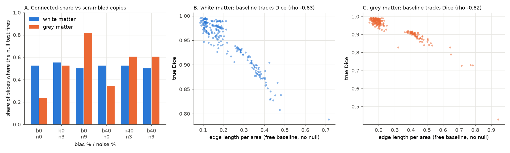

# Does the Segmentation See Anatomy?

A shuffle test for brain MRI tissue maps, run on BrainWeb simulated brains where the true tissue labels are known.

Project 2, after [structure-or-texture](https://github.com/Kaaiyy/structure-or-texture) (retina). Same idea, a different organ.

## The question

A tissue segmentation can look fine and still be wrong. Which measures of a segmentation actually tell you it found real anatomy, and which ones a scrambled image would also pass?

## What I found

- **Volume does not notice the shuffle.** Tissue area is 1.0 times the scrambled average in every condition. This is partly by construction: the scrambling keeps the brightness histogram.
- **The null test is not reliable on a single image.** Connected-share of white matter beats the scrambled copies in only about half of the slices (50 to 55%), at every noise level. For grey matter it ranges from 24% (clean) to 82% (0% bias, 9% noise).
- **A free baseline beats the null test as a quality signal.** Edge length per area of the real segmentation, with no scrambling at all, tracks the true Dice score at Spearman -0.83 (white matter) and -0.82 (grey matter). The null-test ratios track Dice much more weakly.
- So the null test answers "is this structure or texture?", not "how good is this segmentation?". Same lesson as the retina project.

## Results (19 subjects, 38 slices, subject 04 left out)

White matter, true Dice against each measure (Spearman, pooled over conditions, subject-bootstrap 95% CI):

    edge length per area (real, no null)   -0.83  (-0.85 to -0.81)
    connected-share (real, no null)         0.46  ( 0.42 to  0.51)
    connected-share / scrambled mean        0.16  ( 0.11 to  0.21)
    edge length / scrambled mean           -0.40  (-0.46 to -0.33)

Grey matter:

    edge length per area (real, no null)   -0.82  (-0.86 to -0.80)
    connected-share (real, no null)         0.63  ( 0.59 to  0.67)
    connected-share / scrambled mean       -0.42  (-0.53 to -0.31)
    edge length / scrambled mean            0.35  ( 0.27 to  0.46)

Step 4 used one subject (04) and the null test fired in all 9 conditions. Across 19 subjects it did not. Subject 04 was exploratory, so it is excluded from the numbers above.

## How it works

1. BrainWeb gives true tissue labels (CSF, grey matter, white matter) for 20 simulated brains.
2. I build a T1-like image from the labels: fixed tissue brightness, a 1-voxel blur for partial volume, a smooth multiplicative bias field (20% means 0.90 to 1.10, like BrainWeb's definition) and Gaussian noise.
3. Segment with k-means (4 clusters: background, CSF, grey matter, white matter).
4. Make 19 scrambled copies of each image (IAAFT: same spectrum and brightness histogram, structure destroyed) and segment them the same way.
5. Compare area, connected-share and edge length of the real segmentation against the scrambled ones. Minimum possible p is 0.05 with 19 copies.
6. Compare each measure to the true Dice score.

Conditions: bias 0% or 40%, noise 0, 3 or 9% (of white-matter brightness).

## Steps

- step01: download one subject and look at the labels
- step02: simulate T1 images at different bias and noise
- step03: k-means baseline, Dice against truth
- step04: null test on one subject
- step05: null test on all 20 subjects, 2 slices each
- step05b: summary tables and baseline comparison
- step06: summary figure

## Run it

    pip install brainweb numpy scipy scikit-learn pandas matplotlib joblib tqdm requests
    python step01_look.py
    python step05_many.py
    python step05b_summary.py
    python step06_figure.py

The brain files are downloaded by script into `data/` and are not committed. Step 5 took a few minutes on a laptop.

## Honest limits

- The images are my own simulation from labels: no real tissue texture, Gaussian (not Rician) noise, brightness values I chose. Results may not carry over to real scans.
- Dice is measured against BrainWeb's own labels.
- Only 2 slices per subject, one segmentation method (k-means on intensity), and one scrambling method.
- p values come in steps of 0.05 and there is no multiple-testing correction.
- I could not find anyone applying this scrambling null to brain tissue segmentation, but my search was shallow. I am not claiming it is new.

## Credits and references

- BrainWeb simulated brain database: Cocosco et al. 1997 (NeuroImage 5(4), S425) and Aubert-Broche, Collins, Evans 2006, "A new improved version of the realistic digital brain phantom". The 2006 reference is listed as "in review" on the BrainWeb page, so its final citation still needs checking.
- brainweb Python package by Casper da Costa-Luis, used to download the labels.
- IAAFT surrogates: Schreiber and Schmitz 1996. Not yet verified.
- BrainWeb's terms do not state a licence in the FAQ I checked, so no BrainWeb data is committed here.
